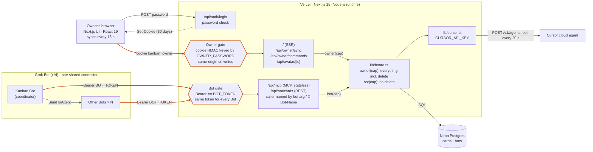
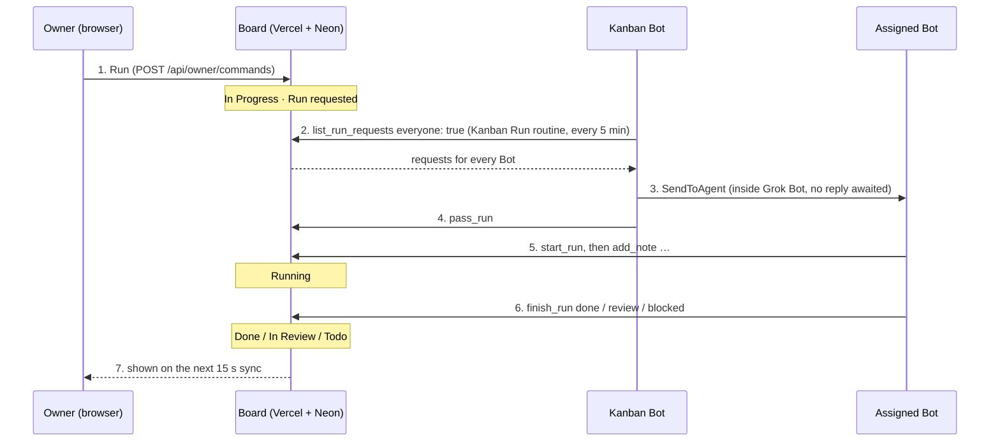

# Architecture

How the board is put together as of October 2026, with the authentication paths drawn out. GitHub renders the diagrams below.

## Components and entry points

There are two ways in, and each is guarded by one shared secret from the Vercel environment. Past the gates only two capabilities remain, `Owner` and `Bot` (`lib/auth.ts`); neither carries a user or Bot identity. There is no middleware: every route calls `requireOwner` or `requireBot` itself, and the SSR page reads the cookie directly.

## Running a card

Grok Bot has no API that starts a Bot from outside, so the board only queues run requests and the Bots come to fetch them.

Step 3 happens inside Grok Bot, so the board only knows about it through the `pass_run` record. Requests for the Kanban Bot itself go straight to steps 5 and 6. Steps 2 to 6 all use the same `BOT_TOKEN`, and each Bot names itself with the `bot` argument.

## Authentication paths

| Path | Used by | Credential | Who is calling | Limits for multi-user |
| --- | --- | --- | --- | --- |
| `/api/auth/login` | Owner | Matches `OWNER_PASSWORD` (constant-time compare) | Nobody in particular | One password; there are no accounts. |
| `/`, `/api/owner/*`, `/api/avatar/*` | Owner | Cookie `v1.<expiry>.<HMAC>`, 30 days. Writes also need a same-origin `Origin` | Nobody in particular (`Owner` capability only) | The signing key is the password itself, so one session cannot be revoked and changing the password signs everyone out. The cookie holds no user id. |
| `/api/mcp` | Every Grok Bot | `Authorization: Bearer BOT_TOKEN` | `bot` argument, self-declared | Anyone with the token can act under any name, and a new name joins the roster. Grok Bot connectors are account-wide, so per-Bot tokens depend on Grok Bot. |
| `/api/bot/cards` | Bots, scripts | Same `BOT_TOKEN` | Optional `X-Bot-Name` header, self-declared | Same as MCP. The xAI API's remote MCP tool uses this token too. |
| Cursor API (outbound) | Server | `CURSOR_API_KEY` | One Cursor account | Every user would share one Cursor account and the repositories its key reaches. |

## What an auth redesign has to touch

- The `Owner` and `Bot` capabilities hold no identity. Adding users means putting a user id into the capability and passing it through every operation in `lib/board.ts`.
- The data has no owner column either: two tables, `cards` and `bots`, and one board. Whether several people share one board or each gets their own decides how much the schema changes.
- A Bot's identity is whatever name it gives. Stopping impersonation needs either a token per Bot (if Grok Bot can hold separate connectors) or a token tied to a user, so a Bot can only act as that user's Bot.
- The owner side has two paths: the SSR page reads the cookie itself, and the API routes go through `requireOwner`. A new scheme has to replace both at once.
