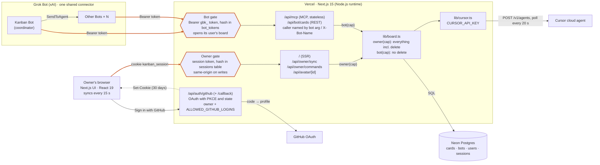
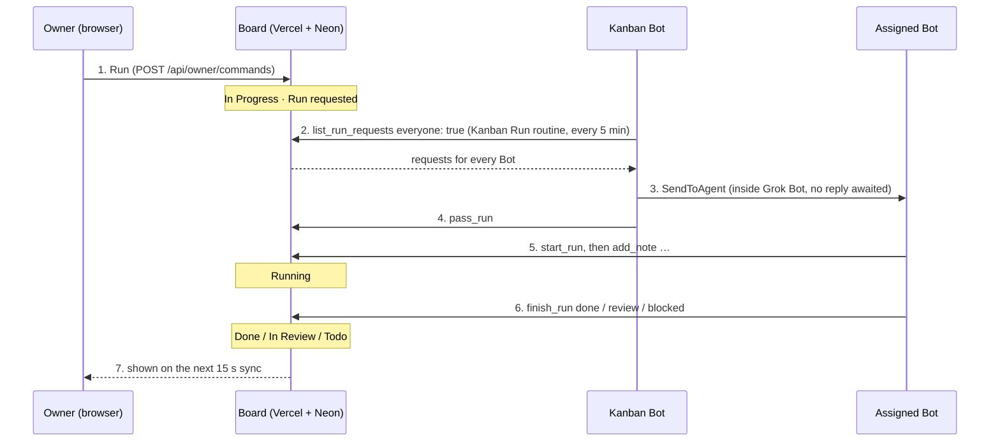

# Architecture

How the board is put together as of October 2026, with the authentication paths drawn out. GitHub renders the diagrams below.

## Components and entry points

There are two ways in. The owner signs in with GitHub and gets a session kept in the database (`lib/accounts.ts`); a user's Bots use a token made on that user's board (`bot_tokens`). Each gate hands the route a capability, `Owner` or `Bot` (`lib/auth.ts`), with the user it belongs to, and the route opens that user's board: a store whose every query is limited to the user's rows (`lib/store.ts`). There is no middleware: every route calls `requireOwner` or `requireBot` itself, and the SSR page looks up the session directly.

## Running a card

Grok Bot has no API that starts a Bot from outside, so the board only queues run requests and the Bots come to fetch them.

Step 3 happens inside Grok Bot, so the board only knows about it through the `pass_run` record. Requests for the Kanban Bot itself go straight to steps 5 and 6. Steps 2 to 6 all use the board owner's connector token, and each Bot names itself with the `bot` argument.

## Authentication paths

| Path | Used by | Credential | Who is calling | Limits for multi-user |
| --- | --- | --- | --- | --- |
| `/api/auth/github`, `/api/auth/github/callback` | Owner | GitHub OAuth with PKCE and a one-time state cookie, no scopes | The GitHub account, recorded in `users` | `OWNER_GITHUB_LOGIN` and `ALLOWED_GITHUB_LOGINS` (or `*`) are let in; the owner takes over rows from before accounts at sign-in. |
| `/`, `/api/owner/*`, `/api/avatar/*` | Owner | Cookie `kanban_session`: a random token whose SHA-256 is in `sessions`, 30 days. Writes also need a same-origin `Origin` | A user, but routes only get the `Owner` capability | Sessions end one by one on sign-out. The board itself is still one, with no owner column. |
| `/api/auth/logout` | Owner | Same-origin POST | The session's user | Deletes the session row. |
| `/api/mcp` | Every Grok Bot | `Authorization: Bearer gbk_…`, a token made on a board; its SHA-256 is in `bot_tokens` | The token's user, then the `bot` argument, self-declared | Bots of one user can still act under each other's names, since Grok Bot connectors are account-wide. They cannot reach another user's board. |
| `/api/bot/cards` | Bots, scripts | Same tokens | The token's user, then the optional `X-Bot-Name` header | Same as MCP. |
| `/api/owner/tokens` | Signed-in user | Session; writes also need a same-origin `Origin` | The session's user | Makes, lists, and revokes that user's tokens only. |
| `BOT_TOKEN` (old, optional) | Connectors from before per-user tokens | `Authorization: Bearer BOT_TOKEN` | The owner | Opens the owner's board while it is set. Remove it once the connectors use board tokens. |
| Cursor API (outbound) | Server | `CURSOR_API_KEY` | One Cursor account | Every user would share one Cursor account and the repositories its key reaches. |

## Boards per user

- `cards` and `bots` carry `user_id`; external ids, Bot ids, and Bot names are unique per user (`drizzle/0003_boards_per_user.sql`).
- Rows from before accounts have no user; the owner takes them over at their next sign-in.
- `getBoard(user)` in `lib/runtime.ts` opens a board for one user, with Cursor only for the owner.
